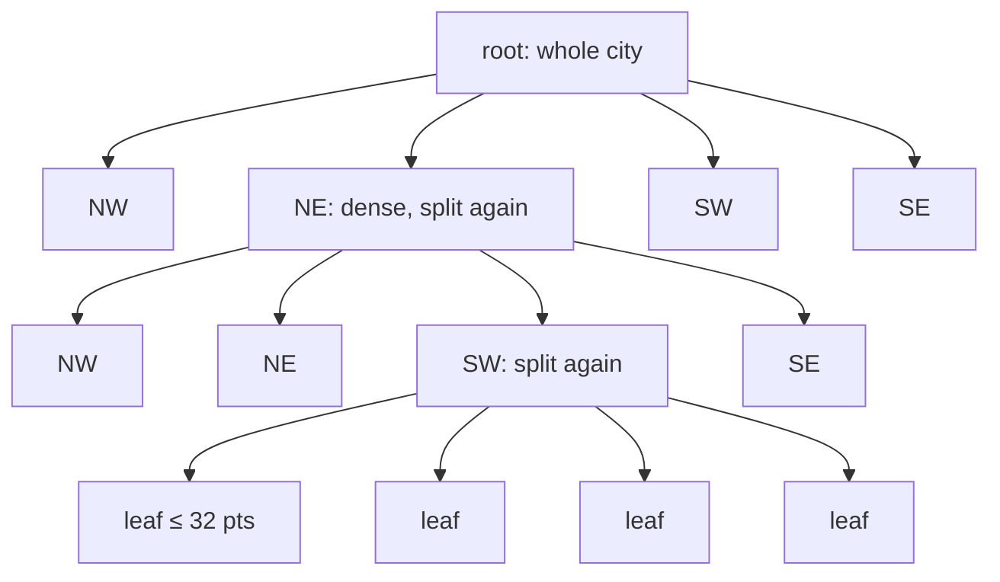
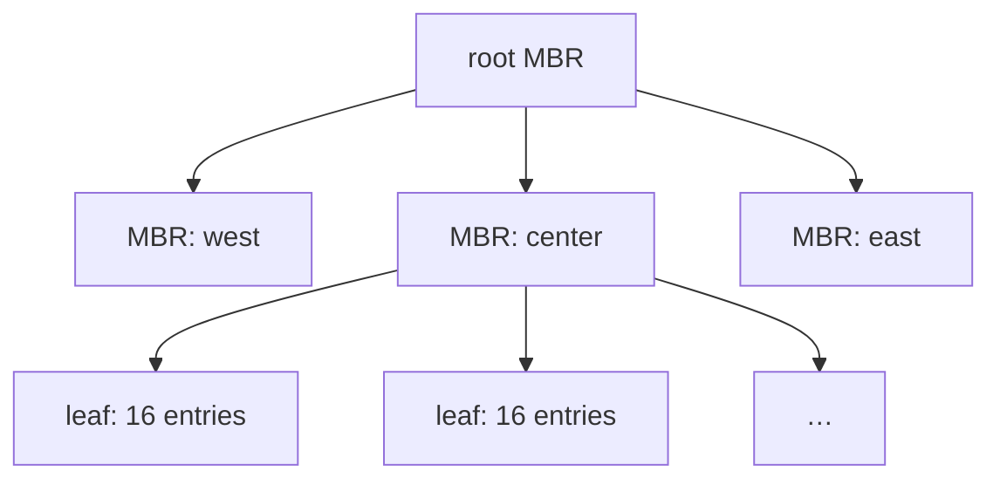

<div align="center">

# proximity-search

**Geohash vs Quadtree vs R-tree vs B-tree, measured on 1 million points.**

Header-only C++20 implementations of the spatial indexes from the
[Hello Interview proximity search deep dive](https://www.hellointerview.com/learn/system-design/deep-dives/proximity-search),
run against the queries real location apps make, and checked against a brute-force scan on every single query.


</div>

## TL;DR

There is no single fastest structure. Each scenario has a different winner, and the reasons are mechanical:

| Scenario | Winner | Runner-up | Why |
|---|---|---|---|
| Radius 500 m | R-tree | Quadtree, Geohash (within ~15%) | Packed, cache-friendly nodes; prunes on exact distance to boxes |
| Radius 5 km (56k hits) | R-tree | Quadtree | Output-bound; the R-tree streams contiguous leaves fastest |
| Nearest neighbour (k = 1) | Quadtree | R-tree | Best-first walk visits a handful of small nodes; 1,494× faster than a scan |
| k = 20 nearest | Quadtree | R-tree | Same walk, a few more leaves |
| Point in polygon | Geohash | R-tree | One hash lookup; no tree to descend |
| Polygon overlap | three-way tie | | ~280 hits per query, so the exact polygon test dominates |
| Build time | Geohash / B-tree | | Just a sort |

If you can only pick one, pick the R-tree. It is never far from first place in any scenario, and it indexes rectangles natively, which is why PostGIS uses an R-tree-like GiST index. Pick a geohash when you need cheap writes, easy sharding, or Redis (`GEOADD`/`GEOSEARCH` is a geohash over a sorted set). Pick a quadtree for an in-memory "find the nearest" service over very uneven data.

A plain B-tree on latitude is 10 to 25× faster than scanning, and up to 60× slower than the spatial indexes, because it can only narrow one axis.

## The structures

All five live in [`include/`](include), each in one short header with no dependencies.

### Naive scan, [`naive.hpp`](include/naive.hpp)

Tests every point. It is the baseline and the oracle: every other index must return exactly what it returns.

### B-tree on latitude, [`btree_index.hpp`](include/btree_index.hpp)

What you get from `CREATE INDEX ON places(lat)` in a relational database. A binary search finds the start of the latitude band, then every row in that band is filtered by longitude and distance. A 500 m query on a 50 km city still touches about 2% of the dataset.

```
lat ▲
    │ · · · · · · · · · · · · · ·
    │═════════════════════════════  ◀ scanned band: the whole width of the city
    │ · · · · · · · ◉ · · · · · ·      (◉ = query circle)
    │═════════════════════════════
    │ · · · · · · · · · · · · · ·
    └─────────────────────────────▶ lng
```

### Geohash, [`geohash.hpp`](include/geohash.hpp)

Longitude and latitude bits are interleaved (Morton order) into one 52-bit integer, so nearby points get nearby numbers, and every geohash prefix is a contiguous range of the sorted array. A radius query picks the finest precision whose cell is still at least `r` wide, then scans the query's cell and its 8 neighbours, which is 9 binary searches. Base32 geohash strings like `6gyf4` (central São Paulo) are the same bits, 5 per character.

```
┌──────┬──────┬──────┐
│  NW  │  N   │  NE  │   cell size ≥ r, so the circle
├──────┼──────┼──────┤   cannot leave this 3×3 block
│  W   │ (◉)  │  E   │
├──────┼──────┼──────┤
│  SW  │  S   │  SE  │
└──────┴──────┴──────┘
```

For polygons, each zone is registered in every fixed-size cell its bounding box touches, in a hash map from cell to zone ids.

### Quadtree, [`quadtree.hpp`](include/quadtree.hpp)

A leaf splits into four quadrants once it holds more than 32 points, so the tree is deep downtown and shallow in the suburbs. Radius search prunes any node whose box is farther than `r`. k-NN is a best-first search: a priority queue always expands the closest unexplored node and stops when that node is farther than the current k-th best point.



Polygons use an MX-CIF quadtree: each zone is stored in the deepest node whose quadrant fully contains it, so nothing is duplicated, but zones that cross a split line get stuck near the root.

### R-tree, [`rtree.hpp`](include/rtree.hpp)

Bulk-loaded with Sort-Tile-Recursive (STR): sort by x, cut into vertical slices, sort each slice by y, pack runs of 16 into leaves, and repeat one level up. Every node is the bounding box of its children, and nodes can overlap. One tree type serves both points (zero-area boxes) and polygons (their bounding boxes).



## Scenarios

The dataset is a 50 × 50 km box over greater São Paulo. 70% of the points sit around 12 Gaussian hotspots (σ ≈ 2 km) and 30% are spread uniformly, because real location data is clustered and clustering is what separates adaptive trees from fixed grids. Queries are drawn from the same distribution, so they land where people are.

| # | Query | Real-world example |
|---|---|---|
| 1 | All points within 500 m | Drivers near a rider |
| 2 | All points within 5 km | Restaurants in my area |
| 3 | Nearest point | Closest available driver |
| 4 | 20 nearest points | 20 closest stores |
| 5 | Zones containing a point | Which delivery zones cover this address? |
| 6 | Zones overlapping a polygon | Which existing zones does a new zone collide with? |

Zones are 20,000 convex polygons with 5 to 8 vertices and radii of 0.2 to 1.5 km. Scenario 6 queries with polygons of 0.5 to 3 km. Polygon tests are exact (separating axis theorem), not bounding-box approximations.

## Results

`1,000,000 points · 20,000 zones · 2,000 queries per scenario · AMD Ryzen 5 5600GT · g++ 15.2 -O3 -march=native · WSL2`

Times are the best of 3 runs. Bold marks the fastest. The full output, including build times, is in [`results.md`](results.md).

### 1. Radius search: 500 m

_avg 960 results/query_

| Structure | µs / query | queries / s | vs naive | correct |
|---|---:|---:|---:|:---:|
| Naive scan | 888.34 | 1,126 | 1.0× | ✅ |
| B-tree (lat) | 86.85 | 11,515 | 10.2× | ✅ |
| Geohash | 13.69 | 73,025 | 64.9× | ✅ |
| Quadtree | 13.23 | 75,608 | 67.2× | ✅ |
| **R-tree (STR)** | **11.60** | 86,183 | 76.6× | ✅ |

### 2. Radius search: 5 km

_avg 56,068 results/query_

| Structure | µs / query | queries / s | vs naive | correct |
|---|---:|---:|---:|:---:|
| Naive scan | 1551.93 | 644 | 1.0× | ✅ |
| B-tree (lat) | 1033.85 | 967 | 1.5× | ✅ |
| Geohash | 655.80 | 1,525 | 2.4× | ✅ |
| Quadtree | 622.48 | 1,606 | 2.5× | ✅ |
| **R-tree (STR)** | **453.01** | 2,207 | 3.4× | ✅ |

### 3. Nearest neighbour (k = 1)

| Structure | µs / query | queries / s | vs naive | correct |
|---|---:|---:|---:|:---:|
| Naive scan | 1295.27 | 772 | 1.0× | ✅ |
| B-tree (lat) | 52.81 | 18,936 | 24.5× | ✅ |
| Geohash | 13.39 | 74,683 | 96.7× | ✅ |
| **Quadtree** | **0.87** | 1,153,600 | 1494.2× | ✅ |
| R-tree (STR) | 1.95 | 513,326 | 664.9× | ✅ |

### 4. k-nearest (k = 20)

| Structure | µs / query | queries / s | vs naive | correct |
|---|---:|---:|---:|:---:|
| Naive scan | 1294.91 | 772 | 1.0× | ✅ |
| B-tree (lat) | 59.81 | 16,719 | 21.6× | ✅ |
| Geohash | 21.19 | 47,183 | 61.1× | ✅ |
| **Quadtree** | **3.34** | 299,749 | 388.1× | ✅ |
| R-tree (STR) | 4.55 | 219,827 | 284.7× | ✅ |

### 5. Point in polygon

_avg 34.8 zones/query_

| Structure | µs / query | queries / s | vs naive | correct |
|---|---:|---:|---:|:---:|
| Naive scan | 65.00 | 15,386 | 1.0× | ✅ |
| **Geohash** | **3.67** | 272,702 | 17.7× | ✅ |
| Quadtree | 9.49 | 105,427 | 6.9× | ✅ |
| R-tree (STR) | 4.49 | 222,511 | 14.5× | ✅ |

### 6. Polygon overlap

_avg 282 zones/query_

| Structure | µs / query | queries / s | vs naive | correct |
|---|---:|---:|---:|:---:|
| Naive scan | 139.55 | 7,166 | 1.0× | ✅ |
| **Geohash** | **52.00** | 19,230 | 2.7× | ✅ |
| Quadtree | 56.57 | 17,676 | 2.5× | ✅ |
| R-tree (STR) | 61.12 | 16,361 | 2.3× | ✅ |

### Build time

| Structure | 1M points (ms) | 20k zones (ms) |
|---|---:|---:|
| B-tree (lat) | 89 | |
| Geohash | 93 | 2.6 |
| Quadtree | 257 | 1.4 |
| R-tree (STR) | 200 | 3.1 |

## Why the winners win

Radius search is mostly about memory layout. Once an index has narrowed the search to the right neighbourhood, the work left is reading candidates. The STR R-tree stores 16 entries per leaf in one contiguous array, sorted so that neighbouring leaves are neighbours in memory too. The geohash array has the same property along its Z-curve, but its 9 cells are larger than the circle, so it reads at least 2.9× more area than it needs (9 cells of side ≥ r against a circle of πr²). Layout shows up clearly in the quadtree: with only ids in its leaves and coordinates looked up in the main array, one pointer chase per candidate made it 2.7× slower (35.4 µs against 13.2 µs), so the leaves keep coordinates inline.

At 5 km every index degrades to "copy 56,000 ids", and the gap to the scan shrinks to 2 or 3×. Large radius queries are output-bound, and no index fixes that. Paginate or rank instead.

Nearest neighbour is where the trees pull away. The quadtree and R-tree walk outward from the query and stop as soon as no unexplored node can beat the current best. A geohash or B-tree has no notion of "closer node", so it has to guess a radius and double it until enough points fall inside (`knnByExpandingRadius` in [`geo.hpp`](include/geo.hpp)), paying for every miss. The quadtree probably edges out the R-tree because each expansion pushes 4 children onto the priority queue instead of 16, so it does fewer heap operations per level. That is an educated guess; it has not been profiled.

Point in polygon favours the grid. The geohash index answers with one hash lookup and a short candidate list. The R-tree has to descend about four levels, and its nodes overlap. The MX-CIF quadtree is clearly last: a zone that touches a split line is stored at that line's level, so a lookup re-tests the zones parked near the root on every query.

Polygon overlap is a three-way tie because each query returns about 280 zones, and the exact SAT test on those candidates costs more than finding them.

Building is cheapest for the flat indexes. The geohash and B-tree are a single sort. The quadtree allocates a `std::vector` per node, and the R-tree sorts once per level.

## Methodology and fairness

- Correctness is checked on every query. Each run folds every result set into an order-independent checksum and compares it with the naive scan. Any missing or extra id turns a ✅ into ❌ and makes the process exit non-zero.
- Every point index keeps coordinates inline next to the id, so none of them wins or loses on cache misses alone.
- Distances use an equirectangular projection at São Paulo's latitude (within ~0.3% of haversine at city scale). Because it is exact in its own plane, results can be compared bit for bit and box pruning is a true lower bound.
- Tunables: leaf capacity 32 (quadtree), fan-out 16 (R-tree), 26 bits per axis (geohash), 14-bit cells for geohash zones. These are reasonable defaults and were not tuned to make any structure win.
- Runs are single-threaded, best of 3, with no other warm-up. Timings on WSL2 move by about ±10% between runs, so treat gaps smaller than that as ties.

## Run it

```bash
make run                     # build and run with defaults (1M points, 2k queries, 20k zones)
./bench 5000000 1000 50000   # points, queries per scenario, zones
make test                    # small dataset; fails if any index disagrees with the naive scan
make docker                  # no compiler installed? builds and runs in an Alpine container
```

The only requirement is a C++20 compiler.

## Layout

```
include/
  geo.hpp          points, boxes, convex polygons, SAT, k-NN heap, data generators
  naive.hpp        brute-force baseline (the oracle)
  btree_index.hpp  sorted-by-latitude range scan
  geohash.hpp      Morton-coded geohash for points + cell hash map for zones
  quadtree.hpp     point quadtree + MX-CIF quadtree for zones
  rtree.hpp        STR bulk-loaded R-tree for points and zones
src/bench.cpp      scenarios, timing, verification, Markdown output
results.md         raw output of the run above
```

## What is not covered

- Updates: All indexes are built once. Moving drivers would favour the geohash (re-sort one key) and the quadtree (local insert and delete) over a bulk-loaded R-tree, which would need R*-tree style inserts.
- Disk and distribution: Everything is in memory. On disk, page-sized R-tree nodes and geohash range scans are what databases use, and geohash prefixes shard trivially.
- The whole globe: The planar metric and the 3×3 geohash neighbourhood assume one city, far from the poles and the antimeridian.
- Other structures, such as k-d trees, S2/H3 cells, and uniform grids.

## Reference

[Proximity Search deep dive](https://www.hellointerview.com/learn/system-design/deep-dives/proximity-search), Hello Interview.
